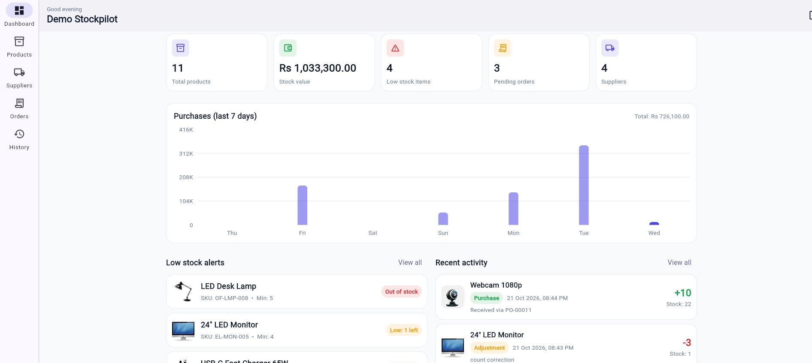
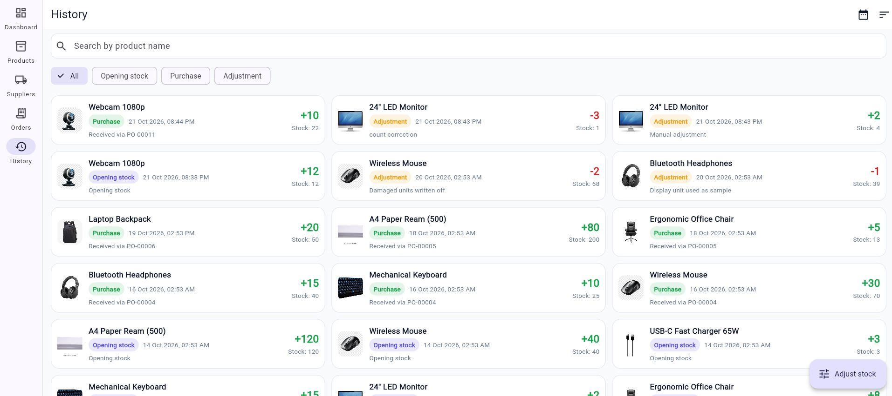
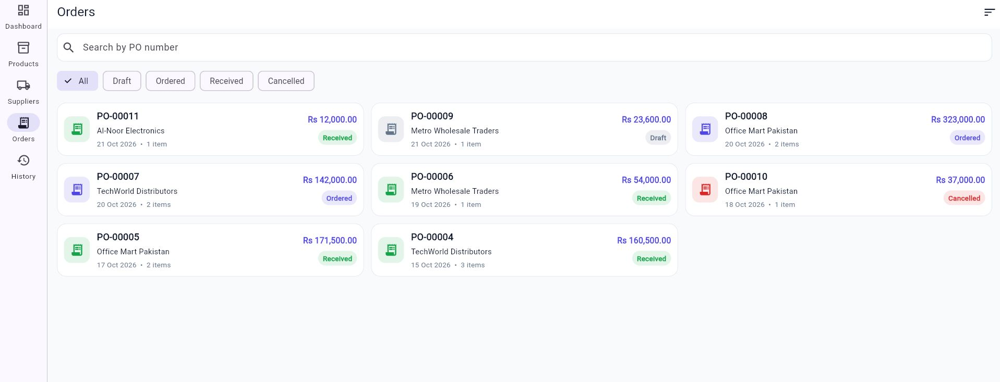
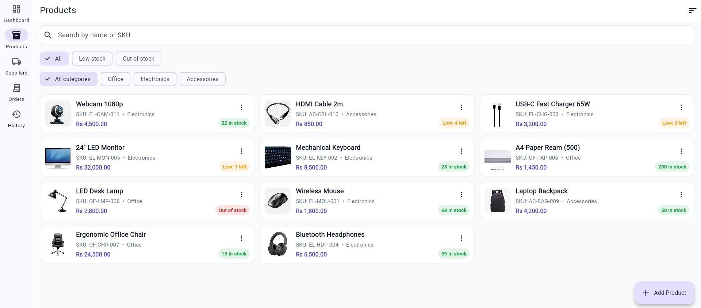
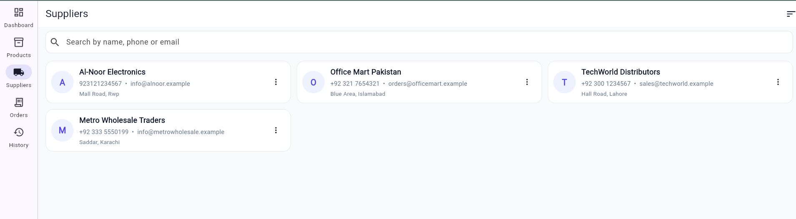
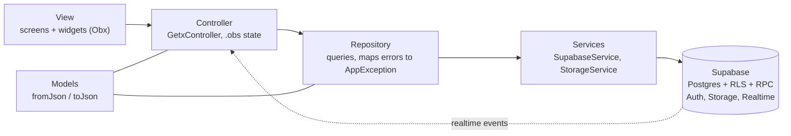
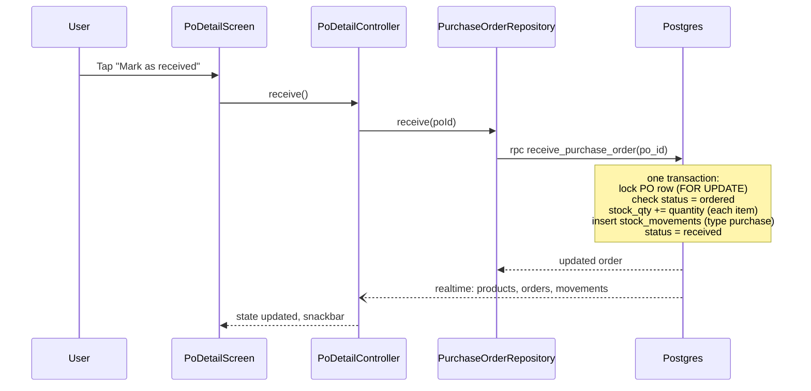
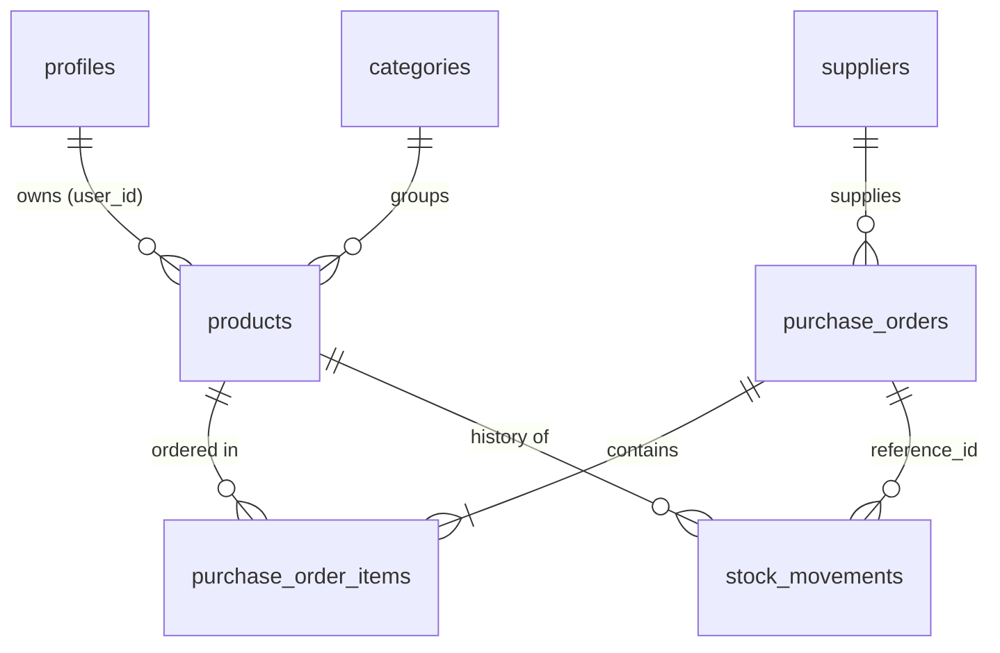

# StockPilot

**Inventory & purchase management app built with Flutter, GetX and Supabase.**
Track products and suppliers, raise purchase orders, and let the database keep stock levels and an audit trail correct automatically.

> Demo video: **https://www.loom.com/share/a931ce0ae8dc46bdbd77bab606f33ab6**  |  APK: **https://github.com/hwb06/Stockpilot/releases/download/v1.0.0/app-release.apk**

<!-- App Screenshots
<p>
  
  
  
  
  
</p>
-->

---

## 1. The problem

A small trading business usually runs stock on paper or spreadsheets. Three things go wrong again and again:

1. Stock numbers drift because someone forgets to update them after a delivery.
2. Nobody can answer "why does the system say 3 units?" because there is no history.
3. Two people editing at once overwrite each other.

## 2. The solution

StockPilot treats **stock as something the database owns, not the UI**. The app never writes a stock number directly. Receiving a purchase order or adjusting stock goes through Postgres functions that update quantity, write a history row and change status in **one atomic transaction**. The Flutter app is a fast, real-time window on top of that.

## 3. Features

| Area | What it does |
|---|---|
| Auth | Email/password register and login, persistent session, logout confirmation |
| Dashboard | Total products/suppliers, stock value, low-stock count, pending orders, 7-day purchase chart, low-stock list, recent activity, **live updates** |
| Products | Create/edit/delete, image upload (camera or gallery), categories, search, low-stock/in-stock filter, sorting, infinite scroll |
| Suppliers | CRUD, search, sorting |
| Purchase orders | Multi-item orders, auto PO numbers (`PO-00001`), status flow `draft > ordered > received / cancelled`, receive action that updates stock |
| Inventory history | Every stock change (opening, purchase, adjustment) with `stock after`, filter by type/date/product, sort |
| Manual adjustment | Add/remove stock with a reason; negative stock is rejected |
| UX | Loading shimmer, empty and error states with retry, pull-to-refresh everywhere, responsive (bottom bar on phones, navigation rail on wide screens) |

## 4. Tech stack

| Layer | Choice | Why |
|---|---|---|
| UI | Flutter (Dart 3.7+) | One codebase, responsive layouts |
| State / DI / routing | GetX | Bindings give lazy, lifecycle-aware DI; `Obx` gives fine-grained rebuilds |
| Backend | Supabase (Postgres, Auth, Storage, Realtime) | Real SQL, Row Level Security, no custom server to maintain |
| Charts | fl_chart | Lightweight, no native code |
| Others | cached_network_image, image_picker, shimmer, intl, flutter_dotenv | |

## 5. Architecture

**MVC with a repository layer.** Views never talk to Supabase; controllers never see raw errors.



### Receiving a purchase order (the core flow)



### Data model



Tables: `profiles`, `categories`, `products`, `suppliers`, `purchase_orders`, `purchase_order_items`, `stock_movements`.
Generated columns keep derived data honest: `products.is_low_stock` and `purchase_order_items.line_total`.

## 7. Problems I hit and how I fixed them

- **"TextEditingController used after dispose"**: `Get.offAllNamed` disposed controllers while the widget was still building. Moved text controllers into the screen `State`.
- **RLS error on product insert**: the opening-stock trigger could not write to `stock_movements` (no client insert policy, by design). Fixed in `003` by making the trigger `security definer` with a fixed `search_path`.
- **Dropdown assertion on edit**: the saved category was missing from the loaded list for a moment. Seed the list with the product's own category first.
- **Stale search results**: a slow older request could overwrite a newer one. Added a request id so only the latest response is applied.

## 9. Getting started

### Prerequisites
- Flutter **3.29 or newer** (project uses Dart `^3.7.2`)
- A free [Supabase](https://supabase.com) project

### Step 1: Supabase
1. Create a new project.
2. **Authentication > Providers > Email**: turn **Confirm email OFF** (so sign-up works instantly).
3. **SQL Editor**: run these files **in order**, each as a new query:
    1. `supabase/migrations/001_init_stockpilot.sql` (tables, RLS, functions, storage bucket, realtime)
    2. `supabase/migrations/002_low_stock_flag.sql`
    3. `supabase/migrations/003_fix_stock_movements_rls.sql`
    4. `supabase/migrations/004_po_status_guard.sql`
4. **Project Settings > API**: copy the **Project URL** and the **anon public** key.

### Step 2: Environment
```bash
cp .env.example .env      # Windows: copy .env.example .env
```
Edit `.env`:
```
SUPABASE_URL=https://YOUR-PROJECT.supabase.co
SUPABASE_ANON_KEY=YOUR-ANON-KEY
```
Use only the **anon** key. Never put the `service_role` key in the app.
`.env` is listed in `pubspec.yaml` assets, so the file must exist before building.

### Step 3: Run
```bash
flutter pub get
flutter run
```

### Step 4 (optional): demo data
1. Register `demo@stockpilot.com` in the app and pwd is Stockpilot
2. You get 10 products, 3 suppliers and 7 purchase orders (received, ordered, draft, cancelled) with consistent history. Product images are not seeded; upload your own in the app.

## 10. Security notes

- The anon key is designed to be public. Protection comes from **RLS policies**, not from hiding the key.
- `.env` is gitignored; only `.env.example` is committed.
- Storage: public read for product images, but users can only write inside their own `<user_id>/` folder.
- Definer functions revoke `anon` execute and always filter by `auth.uid()`.

## 11. Known limitations and next steps

- No automated tests yet. Next: repository unit tests with a mocked Supabase client, and SQL tests for the RPCs.
- Single role per account (no teams or permissions). Next: organisations table and role-based RLS.
- Partial receiving (receiving less than ordered) is not supported; an order is received in full.
- No barcode scanning or CSV import/export.
- English only (strings are centralised, so localisation is a small step).

## 12. Author

**Hussnain Waheed**  |  hussnainwaheed864@gmail.com  |  https://github.com/hwb06
